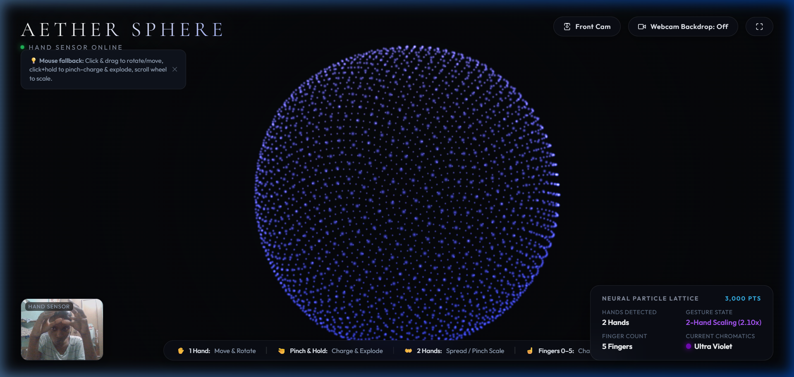

# 🌌 Aether Sphere

> **A real-time, interactive 3D WebGL particle sphere that reacts dynamically to hand gestures via your webcam and MediaPipe Hands.**



---

## ✨ Features

- **🪐 3,000 Particle Lattice**: Evenly distributed on a spherical geometry using the Fibonacci spiral lattice algorithm, rendered with Three.js additive blending and glowing sprite shaders.
- **✋ Single Hand Steering**: Maps palm position in 3D space with smooth cubic interpolation; hand tilt and orientation rotate the sphere in real time.
- **🤏 Pinch & Supernova Burst**: Pinching thumb and index finger fills up a glowing radial SVG charge ring with synthesized frequency sound; releasing explodes the 3,000 particles outwards across the screen before spring-damping physics pulls them back together to reform the sphere.
- **👐 Two-Hand Pinch Scaling**: Detects both hands simultaneously — spread them apart to dynamically scale the sphere up to $2.5\times$, or bring them together to shrink it down to $0.45\times$.
- **☝️ Finger Count Chromatics (0–5)**: Real-time hand landmark heuristics detect extended fingers to shift particle color palettes seamlessly:
  - ✊ **0 Fingers (Fist)**: Magma Crimson (`#ff3344`)
  - ☝️ **1 Finger**: Cyan Ray (`#00f0ff`)
  - ✌️ **2 Fingers**: Neon Emerald (`#10ff88`)
  - 🤟 **3 Fingers**: Solar Amber (`#ffb703`)
  - 🖖 **4 Fingers**: Cyber Orchid (`#f72585`)
  - 🖐️ **5 Fingers (Open Palm)**: Ultra Violet (`#7209b7`)
- **📹 Fullscreen Webcam Backdrop**: Toggle the live mirrored webcam feed as a cinematic background with custom contrast, brightness, and vignette filters.
- **🔄 Multi-Camera & Mobile Support**: Easily cycle through multiple connected cameras (integrated webcams, mobile webcams via Camo / DroidCam / Iriun) or flip between front and rear cameras on mobile devices.
- **🔊 Synthesized Web Audio FX**: Built-in audio oscillator feedback for charge buildup, supernova release, and chromatic shifts without external audio assets.
- **🖱️ Mouse & Keyboard Fallback**: Full desktop fallback support (click & drag to move/rotate, click+hold to pinch-charge, scroll wheel to scale, keys `0`–`5` for colors).
- **📦 Single File & Zero Dependencies**: Fully self-contained in a single `index.html` file with CDN scripts. No build steps, bundlers, or frameworks required.

---

## 🎮 Hand Gestures & Controls

| Gesture | Action | Description |
| :--- | :--- | :--- |
| **1 Hand Move** | Position & Rotate | Move palm to steer; tilt hand to rotate sphere in 3D. |
| **Thumb + Index Pinch** | Charge & Explode | Hold pinch to charge ring; release to trigger supernova burst. |
| **2 Hands Spread / Pinch** | Scale Sphere | Move hands apart to expand ($2.5\times$), bring together to shrink ($0.45\times$). |
| **Finger Count (0–5)** | Chromatic Shift | Show 0 to 5 fingers to morph particle colors smoothly. |
| **Webcam Backdrop** | Toggle Background | Switches between dark void and fullscreen webcam view. |
| **Switch Camera** | Change Camera | Cycles through all connected video input devices or flips front/back. |

---

## 🚀 Quick Start

### 1. Direct Launch
Simply open `index.html` directly in any modern browser:
```bash
# Double-click index.html or open via browser
```

### 2. Local Static Server (Recommended)
Running through a local web server ensures optimal performance and camera permissions:

**Using Node.js:**
```bash
npx serve .
# Or run with Node directly:
node -e "const http=require('http'),fs=require('fs');http.createServer((req,res)=>{const file=req.url==='/'?'index.html':req.url.slice(1);fs.readFile(file,(e,d)=>{if(e){res.statusCode=404;res.end('Not found');}else{res.setHeader('Content-Type',file.endsWith('.html')?'text/html':'text/javascript');res.end(d);}})}).listen(3000,()=>console.log('Open http://localhost:3000'));"
```

**Using Python:**
```bash
python -m http.server 3000
```

Then visit:
```
http://localhost:3000
```

---

## 📱 Using Mobile Devices

### Method A: Use your phone as a PC webcam
Connect your smartphone via USB or Wi-Fi using apps like:
- **[Camo](https://reincubate.com/camo/)**
- **[DroidCam](https://www.dev47apps.com/)**
- **[Iriun Webcam](https://iriun.com/)**

Once installed, click the **"Switch Camera"** button in the top bar to select your phone camera!

### Method B: Open directly on mobile browser
1. Find your computer's local IP address (`ipconfig` on Windows).
2. Connect your smartphone to the same Wi-Fi network.
3. Open `http://<YOUR-PC-IP>:3000` in Safari (iOS) or Chrome (Android).
4. Allow camera permissions and use the **"Front Cam"** button to switch between cameras.

---

## 🛠️ Built With

- **[Three.js](https://threejs.org/)** (v0.128.0) — 3D WebGL scene rendering & particle physics
- **[MediaPipe Hands](https://developers.google.com/mediapipe/solutions/vision/hand_landmarker)** — High-fidelity 21-point hand tracking & ML vision pipeline
- **Web Audio API** — Real-time synthesized acoustic feedback
- **Vanilla CSS & HTML5** — Glassmorphism UI with Google Fonts (*Cormorant Garamond* & *Outfit*)

---

## 📄 License

MIT License © 2026
